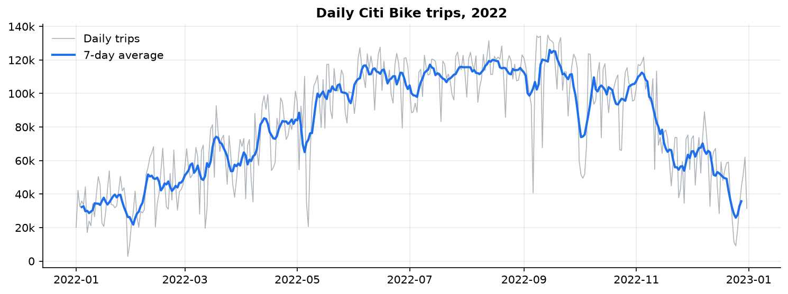
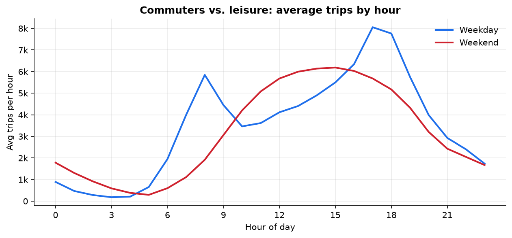
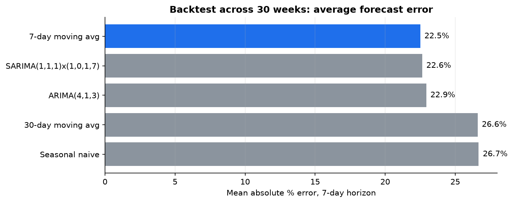
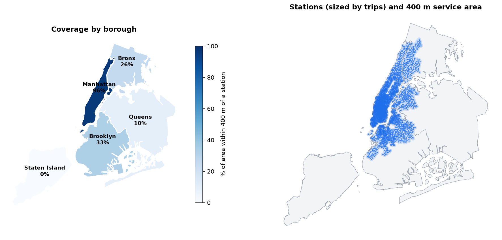

# Citi Bike NYC 2022: Demand, Forecasting and Network Coverage

An end-to-end analysis of all 29.8 million Citi Bike trips taken in New York City in 2022: what
drives demand, how well it can be forecast a week ahead, and where the network leaves New Yorkers
without a bike.

Built for *Emerging Topics in Data Analysis & Management* at IE University (Madrid), Spring 2026.

**[Read the full notebook](notebooks/citibike_analysis.ipynb)**



## Key findings

| | |
|---|---|
| **Seasonality** | August averaged 115k trips/day, 3.5x January (33k). Wednesday runs 10% above a typical day, Sunday 17% below. |
| **Two rider groups** | Weekdays peak at 8 AM and 5 PM (commuters); weekends have one peak at 3 PM (leisure). Casual riders are 14% of trips in winter and 25% in summer. |
| **Forecasting** | Over a 30-week rolling backtest, SARIMA and a 7-day moving average tied at about 22.5% error for a 7-day horizon. Most of what's left is weather. |
| **Anomalies** | 8 days flagged by at least 2 of 3 detection methods, all sharp drops: rainstorms (May 6-7, Sep 6) and the Christmas holiday. |
| **Coverage** | 96% of Manhattan is within 400 m of a station, vs. 33% of Brooklyn, 26% of the Bronx, 10% of Queens and none of Staten Island. |
| **Flows** | Manhattan accounts for 71% of trips. Only 5.4% of trips cross a borough line. |

<table>
<tr>
<td></td>
<td></td>
</tr>
</table>



## What's in the analysis

1. **Data cleaning.** Removed 72k bad records (0.24%): negative durations, sub-60-second false
   starts, trips over 24 hours and trips with no station.
2. **Exploratory analysis.** Daily and hourly patterns, member vs. casual riders, e-bike share and busiest stations.
3. **Decomposition.** Additive vs. multiplicative (multiplicative wins: the weekly swing scales with demand).
4. **Stationarity.** Rolling statistics, Augmented Dickey-Fuller tests and ACF/PACF to choose differencing and a weekly seasonal term.
5. **Forecasting.** Seasonal naive, 7- and 30-day moving averages, ARIMA(4,1,3) and SARIMA(1,1,1)x(1,0,1,7),
   scored on the assignment's holiday-week holdout and on a 30-origin rolling backtest with no look-ahead.
6. **Anomaly detection.** A day is flagged when at least two of three methods agree: SARIMA residual z-scores,
   IQR fences on the seasonally adjusted series, and deviation from the rolling mean.
7. **Live network snapshot.** Pulls the current Citi Bike network from the CityBikes API (2,464 stations today vs. 1,761 in 2022).
8. **Geospatial coverage.** GeoPandas spatial joins, 400 m buffers in a metric projection (UTM 18N) and borough overlays.
9. **Flows.** Busiest corridors, stations that drain or fill up (rebalancing targets) and a borough-to-borough trip matrix.
10. **Recommendations.** Demand-triggered fleet scaling, separate products for commuters and leisure riders, a
    phased outer-borough expansion and timed rebalancing routes.

## Changes from the course submission

The original notebook ran in Google Colab on a 20% random sample of trips. For this version I:

- **Used every trip.** A DuckDB pipeline aggregates the 6 GB of raw CSVs in about 6 seconds.
- **Added a rolling backtest.** The assignment scored models on one week (Dec 25-31). That's a holiday
  week, so every model looked bad (65%+ error). Thirty weekly origins give a fairer comparison.
- **Added a seasonal naive baseline**, so the models have a simple benchmark to beat.
- **Fixed the API step.** It now pulls the Citi Bike network itself; the original picked a different NYC operator.

## Run it

```bash
# 1. Download 2022-citibike-tripdata.zip from https://s3.amazonaws.com/tripdata/index.html and unzip it
#    (and the monthly zips inside it)
# 2. Build the aggregated tables (already committed in data/processed/, so this step is optional)
uv run python scripts/build_dataset.py /path/to/2022-citibike-tripdata
# 3. Run the notebook
uv run jupyter lab notebooks/citibike_analysis.ipynb
```

The notebook is generated from `notebooks/citibike_analysis.py` (jupytext percent format), so diffs stay readable.

```
data/processed/   daily, hourly, station and origin-destination aggregates (built from the raw trips)
data/external/    NYC borough boundaries (GeoJSON)
figures/          charts exported by the notebook
notebooks/        the analysis
scripts/          raw-data aggregation (DuckDB)
```

**Stack:** Python, pandas, DuckDB, statsmodels, GeoPandas, Shapely, matplotlib

## Limitations

- **No weather data**, which is the biggest source of day-to-day forecast error and the clearest next step.
- **One year of history**, so annual seasonality can't be modelled directly.
- **Completed trips only**: the data can't show demand that went unmet because no bike or dock was available.
- **Straight-line distance**: coverage uses 400 m buffers rather than walking routes.

Data: [Citi Bike System Data](https://citibikenyc.com/system-data) (Lyft Bikes and Scooters, LLC), [CityBikes API](https://api.citybik.es),
borough boundaries from [click_that_hood](https://github.com/codeforgermany/click_that_hood).
